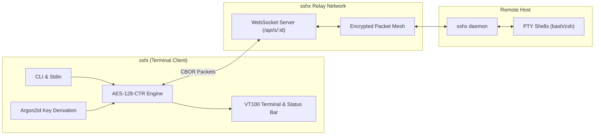
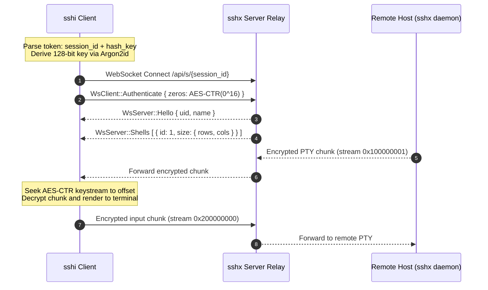

<div align="center">

# sshi

Terminal client for [sshx.io](https://sshx.io) collaborative sessions.

[](https://golang.org)
[](LICENSE)
[](https://github.com/ekzhang/sshx)

</div>

`sshi` connects directly to collaborative `sshx` terminal sessions from your local shell or automated scripts without running a web browser. It attaches over WebSockets, runs terminal raw mode inside your current emulator or tmux pane, and handles end-to-end encryption locally.

---

## Architecture





---

## Features

| Feature | Description |
| :--- | :--- |
| **End-to-End Encryption** | Uses Argon2id key derivation and AES-128-CTR stream cipher seeking matching the sshx protocol. Keystrokes and terminal output remain encrypted across network relays. |
| **Multi-Shell Tabs** | Switch between remote shells using `Ctrl+A` shortcuts, open new shells, and close shells in the session. |
| **Session Bookmarks** | Save session tokens under aliases in `~/.config/sshi/config.json`. Running `sshi` without arguments reconnects to your last active session. |
| **In-Session Chat** | Broadcast messages to other room participants with `Ctrl+A t` and view message history with `Ctrl+A m`. |
| **Scripting and Automation** | Stream command output non-interactively using `sshi run`, or pipe raw stdin and stdout using `sshi pipe`. |
| **Status Bar and Margins** | VT100 scroll margins keep active tabs, participant count, and roundtrip latency visible on the bottom line without breaking terminal scrollback. |

---

## Installation

### From Source (Requires Go 1.22+)

```bash
git clone -q https://github.com/Fire162/sshi.git
cd sshi
make install
```

This compiles a stripped binary and installs it to `/usr/local/bin/sshi`.

<details>
<summary>Manual Go build instructions</summary>

If you prefer building without `make`:

```bash
go build -ldflags="-s -w" -o sshi ./cmd/sshi
install -m 755 sshi /usr/local/bin/sshi
```

</details>

---

## Quick Start

### 1. Connect to a Session

Pass the full web URL or the token identifier:

```bash
# Using the full web URL
sshi https://sshx.io/s/hr2hQ8YKuf#lFRwv8c7cZhJRd

# Using the short token
sshi hr2hQ8YKuf#lFRwv8c7cZhJRd

# Setting a custom participant nickname
sshi -n "alice" hr2hQ8YKuf#lFRwv8c7cZhJRd
```

> [!NOTE]
> The hash fragment after `#` contains the secret encryption key. It is processed locally and never sent to the server in plaintext.

### 2. Bookmark Sessions

Save tokens under memorable aliases so you do not need to paste long URLs:

```bash
# Save a session
sshi save staging "https://sshx.io/s/hr2hQ8YKuf#lFRwv8c7cZhJRd" "Staging server"

# List saved sessions
sshi list

# Connect using the alias
sshi staging

# Reconnect to the last active session
sshi
```

### 3. Non-Interactive Scripting and Agent Pipelines

`sshi` supports execution in automated pipelines:

```bash
# Inspect session metadata, open shells, and latency in JSON
sshi info staging --json

# Run a remote command and exit when finished
sshi run staging "uname -a && uptime"

# Pipe local scripts into the remote shell
cat test-script.sh | sshi pipe staging
```

---

## 🐍 Python SDK (For AI Agents & Automation)

`sshi` includes a native asynchronous Python 3 SDK in [`python/`](python/) for programmatic AI agent integration (LangChain, AutoGen, CrewAI, PydanticAI, or standalone automation).

### Installation

```bash
pip install sshi-py
```

Or install from source:

```bash
cd python && pip install .
```

### Async Python Usage

```python
import asyncio
from sshi import SSHISession

async def main():
    target = "https://sshx.io/s/hr2hQ8YKuf#lFRwv8c7cZhJRd"

    # Connect to the session
    async with SSHISession(target, name="ai-assistant") as session:
        # Run a command and collect output
        output = await session.run("uname -a && uptime")
        print("Command Output:\n", output)

        # Inspect participants
        for user in session.users:
            print(f"User: {user.name} (can_write={user.can_write})")

        # Broadcast chat message
        await session.chat("Hello from autonomous AI agent!")

asyncio.run(main())
```

### Python CLI (`sshi-py`)

```bash
# Run command remotely
sshi-py run "hr2hQ8YKuf#lFRwv8c7cZhJRd" "python3 -c 'print(1337 * 2)'"

# Inspect session in JSON
sshi-py info "hr2hQ8YKuf#lFRwv8c7cZhJRd" --json

# Send chat message to room
sshi-py chat "hr2hQ8YKuf#lFRwv8c7cZhJRd" "Hello room!"
```

---

## Keyboard Shortcuts

`sshi` uses <kbd>Ctrl</kbd> + <kbd>A</kbd> as its command prefix:

| Shortcut | Action |
| :--- | :--- |
| <kbd>Ctrl</kbd> + <kbd>A</kbd> <kbd>c</kbd> | Create a new shell tab in the remote session |
| <kbd>Ctrl</kbd> + <kbd>A</kbd> <kbd>n</kbd> | Switch to next tab |
| <kbd>Ctrl</kbd> + <kbd>A</kbd> <kbd>p</kbd> | Switch to previous tab |
| <kbd>Ctrl</kbd> + <kbd>A</kbd> <kbd>1</kbd> .. <kbd>9</kbd> | Jump directly to tab number |
| <kbd>Ctrl</kbd> + <kbd>A</kbd> <kbd>x</kbd> | Close current shell tab |
| <kbd>Ctrl</kbd> + <kbd>A</kbd> <kbd>t</kbd> | Open broadcast chat prompt |
| <kbd>Ctrl</kbd> + <kbd>A</kbd> <kbd>m</kbd> | View recent chat history modal |
| <kbd>Ctrl</kbd> + <kbd>A</kbd> <kbd>u</kbd> | List connected participants and write permissions |
| <kbd>Ctrl</kbd> + <kbd>A</kbd> <kbd>N</kbd> | Change your participant display name |
| <kbd>Ctrl</kbd> + <kbd>A</kbd> <kbd>b</kbd> | Toggle bottom status bar on or off |
| <kbd>Ctrl</kbd> + <kbd>A</kbd> <kbd>Ctrl</kbd> + <kbd>A</kbd> | Send literal <kbd>Ctrl</kbd> + <kbd>A</kbd> to the remote shell |
| <kbd>Ctrl</kbd> + <kbd>A</kbd> <kbd>d</kbd> or <kbd>q</kbd> | Detach and exit session cleanly |

> [!TIP]
> If you run `tmux` or `screen` inside the session, press <kbd>Ctrl</kbd> + <kbd>A</kbd> twice to pass a literal `Ctrl+A` through to the nested application.

---

## Security Hardening

- **Terminal Injection Protection (CWE-150)**: Participant display names and chat messages are filtered to remove ANSI escape sequences, including CSI cursor movements, OSC title and clipboard modifications, carriage returns, and control characters.
- **Resource Limits**: Chunks are limited to 8 MB. Internal session tracking bounds open shells to 64 and active room users to 512 to prevent memory exhaustion from invalid relay messages.
- **Key Derivation and Isolation**: The 128-bit AES key is derived using Argon2id. Keys can be cleared from memory on exit. Session configuration files in `~/.config/sshi/config.json` are written with POSIX `0600` permissions and directory permissions `0700`.
- **Terminal State Restoration**: Terminal raw mode hooks into deferred panic recovery to ensure terminal line disciplines, cursor visibility, and scroll regions restore cleanly on exit or error.

> [!IMPORTANT]
> Anyone with access to the session URL and its hash fragment has full read access to the encrypted stream. Protect your session tokens accordingly.

---

## Command Reference

```text
Usage:
  sshi [command] [options] [target]

Commands:
  sshi <target>                     Connect directly to a session
  sshi                              Reconnect to the last used session
  sshi save <alias> <target> [note] Save session bookmark
  sshi list, ls                     List all saved sessions
  sshi remove, rm <alias>           Remove saved bookmark
  sshi info <target> [--json]       Inspect session participants, shells, and ping
  sshi run <target> "<cmd>"         Execute command and stream output
  sshi pipe <target>                Direct raw pipe mode for scripts and agents
  sshi help, -h, --help             Display usage information
  sshi version, -v, --version       Print version information

Options:
  -c, --connect <target>            Session target (URL, token ID#key, or alias)
  -s, --server <url>                Custom sshx relay server (default: https://sshx.io)
  -n, --name <name>                 Participant display name
  -w, --write-password <password>   Write password for protected sessions
```

---

## Protocol Specification

<details>
<summary>Technical Protocol and Cipher Details</summary>

`sshi` connects to `sshx-server` over WebSockets (`/api/s/<id>`) using binary CBOR framing.

### 1. Key Derivation (Argon2id)
* **Memory cost**: 19,456 KiB
* **Iterations**: 2
* **Parallelism**: 1
* **Salt**: `"This is a non-random salt for sshx.io, since we want to stretch the security of 83-bit keys!"`
* **Output**: 128-bit AES key

### 2. Stream Cipher (AES-128-CTR)
* **Shell output stream ID**: `0x100000000 | sid` (where `sid` is the 32-bit shell identifier)
* **Client input stream ID**: `0x200000000`
* **Counter IV layout**: 8 bytes big-endian stream ID followed by 8 bytes big-endian block index (`offset / 16`).
* **Offset alignment**: When `offset % 16 > 0`, the keystream discards `(offset % 16)` bytes to maintain stream synchronization.

### 3. Screen Region Allocation
* Sets VT100 scroll margins (`\033[1;<rows-1>r`) so terminal output scrolls cleanly in the main region while the status bar stays anchored on the bottom row.

</details>

---

## Testing

```bash
make test
```

Runs unit tests across the crypto implementation, CBOR wire serializers, bookmark configuration, and URL parser.

---

## License

MIT License. See [LICENSE](LICENSE) for details.
